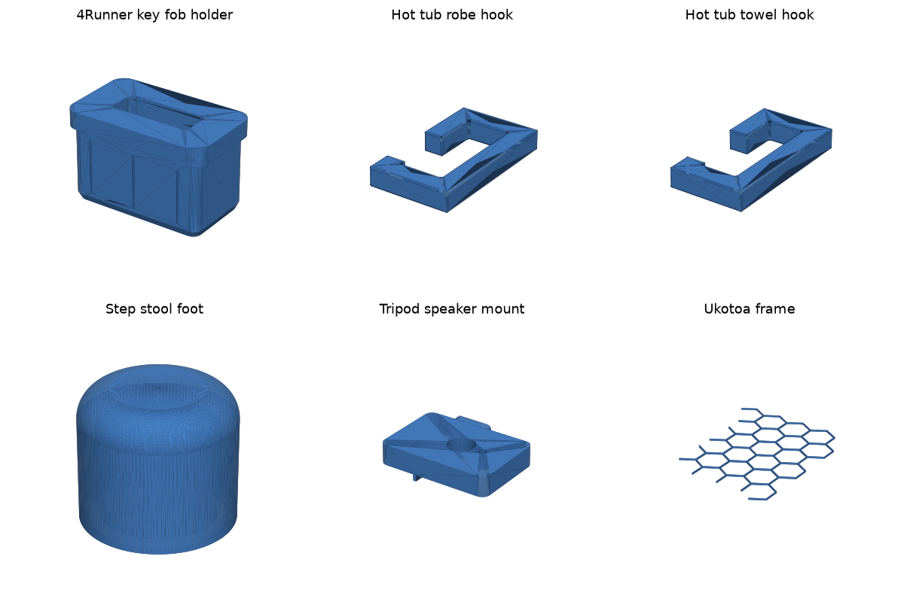
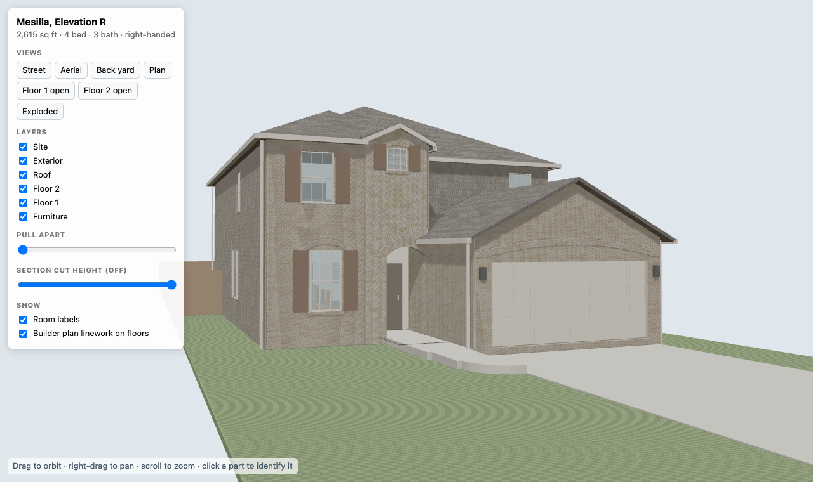
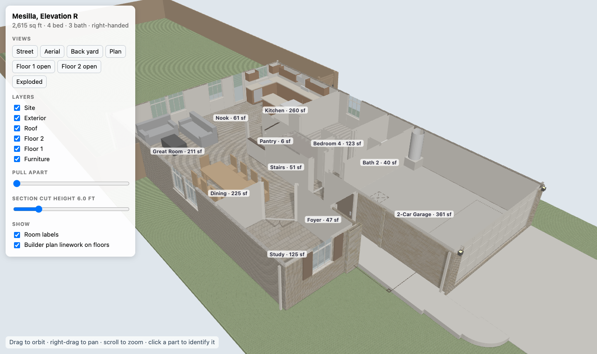
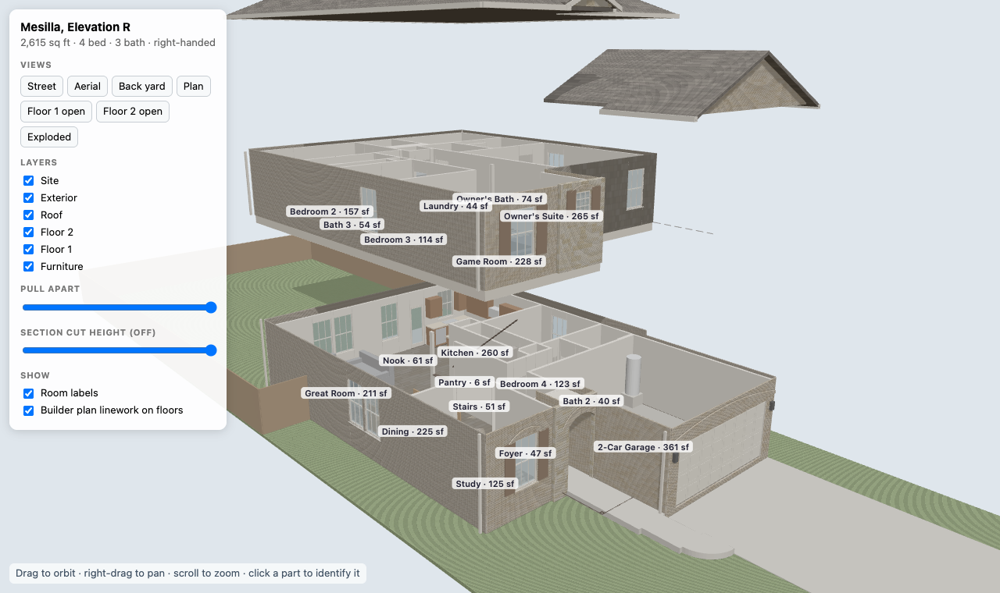

# 3D Models

My 3D printing models: small functional parts I designed for things around the
house and car, plus a scripted 3D model of a two-story house that comes apart by
floor and prints as stackable pieces. Each model has its print-ready STL; most
also have a STEP file or the source it was built from (an OnShape document, an
OpenSCAD file or a Python generator).



## Models

| Folder | What it is | Files |
|---|---|---|
| [4Runner_Key_Fob_Holder](4Runner_Key_Fob_Holder/README.md) | Insert for the center console coin pocket of a 2022 Toyota 4Runner that holds the smart key fob upright. Press fit with crush ribs. | Parametric OpenSCAD source, STL |
| Hot_Tub_Hooks | Two hooks, one for a robe and one for a towel. | STEP, STL, [OnShape document](Hot_Tub_Hooks/OnShape_Document.md) |
| Step_Stool_Foot | Foot for a step stool. | STL, [OnShape document](Step_Stool_Foot/OnShape_Document.md) |
| Tripod_Speaker_Mount | Plate that mounts a speaker on a tripod. | STEP, STL, [OnShape document](Tripod_Speaker_Mount/OnShape_Document.md) |
| Ukotoa_Frame | Hexagon lattice frame. | STEP, STL, [OnShape document](Ukotoa_Frame/OnShape_Document.md) |
| [House_Mesilla](House_Mesilla/README.md) | Detailed model of a two-story Centex "Mesilla" (Elevation R) house, generated in Python from the builder's vector floor plan. Browser viewer, glTF file and four stackable 1:80 print pieces. | Python generator, `plan.json`, HTML viewer, GLB, STL |

The key fob holder and house folders have their own READMEs with
measurements to check, fit notes and print settings.

## House model

`House_Mesilla` is a small pipeline rather than a single CAD file:

1. `extract_plan.py` reads the walls and linework from page 2 of the builder's
   floor plan PDF (vector line art), mirrors it to the right-handed build,
   scales it to the lot survey and writes `plan.json` in feet.
2. `openings.py` finds doors and windows as gaps between wall ends.
3. `build_house.py` turns `plan.json` into walls, cladding, hip and gable
   roofs, stairs, kitchen, baths, furniture and the site, then writes
   `house.glb`, the self-contained `house_viewer.html` and the print STLs.

The viewer has preset views, layer toggles, a pull-apart slider, a section-cut
height slider, room labels with areas and click-to-identify:







Rebuild it with [uv](https://docs.astral.sh/uv/); dependencies are inline
(PEP 723), so no project setup or CAD application is needed:

```bash
cd House_Mesilla
uv run extract_plan.py "<path>/Centex Mesilla Elevation R Rendering and Option Floor Plan.pdf"
uv run build_house.py
```

See [House_Mesilla/README.md](House_Mesilla/README.md) for the file list, print
sizes, guide pins, where every number comes from and the known gaps.

## Printing and editing

- STL files are ready to slice.
- STEP files open in any CAD tool. The OnShape links go to the original
  editable documents.
- The key fob holder is parametric; edit the `.scad` and re-render with
  `openscad -o 4runner_key_fob_holder.stl 4runner_key_fob_holder.scad`.

## Reference docs

`docs/` holds printer reference material: the Ender 3 manual, the Solidoodle
FAQ and a print finish quality tips sheet (`Tips.jpg`).

## External links

- [LTT Printables](https://www.printables.com/@LinusTechTips)
- [LTT Thingiverse](https://www.thingiverse.com/linustech/designs)
- [Hacksmith Thangs](https://thangs.com/designer/hacksmith)

## License

MIT. See [LICENSE](LICENSE).
